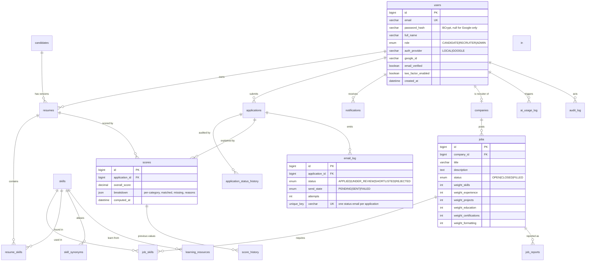

# ResuMatch - Phase 0 plan and architecture notes

This document holds the Phase 0 design artefacts: the folder layout, the database plan, the API
surface as it will grow, and the deployment checklist.

## 1. Stack (confirmed)

| Layer | Choice | Why |
| --- | --- | --- |
| Language | Java 17 language level (`maven.compiler.release=17`) | Fixed requirement; JDK 21 compiles it fine |
| Web | Jakarta Servlets 6.0, WAR | Runs on Tomcat 10.1 (development) and Tomcat 11 (Docker/Render) |
| DB access | Plain JDBC + HikariCP + DAO, no ORM | Every SQL statement is explicit and explainable |
| Schema | Flyway migrations run from a `ServletContextListener` | Versioned, repeatable, never edited after applying |
| JSON | Gson | Small, no framework |
| Frontend | HTML + CSS + ES modules, Bootstrap 5 and Chart.js from CDN | No build step, deploys to Vercel as static files |
| Auth (Phase 1) | BCrypt + server sessions + CSRF token | Simple and easy to defend in a viva |
| Email | `MailSender` interface: SMTP locally, Brevo HTTPS in production | Render's free plan blocks SMTP ports |
| Files | `FileStorage` interface: disk locally, MySQL blobs in production | Render's disk is ephemeral |
| AI (Phase 11+) | Gemini then Groq behind `AiClient` | AI explains only; scores stay deterministic |

## 2. Folder layout

```
resumatch/
  backend/                     Maven WAR project (imports into Eclipse as a Maven project)
    src/main/java/com/resumatch/
      common/config            env + .env loading, fail-fast validation
      common/db                Hikari pool, health monitor, Flyway bootstrap
      common/web               base servlet, error filter, security headers, health servlet
      common/json              Gson wrapper with java.time adapters
      common/exception         ApiException (status-carrying business errors)
      common/storage           FileStorage + LocalDiskFileStorage (DbFileStorage in Phase 3)
      common/mail              MailSender + SmtpMailSender (Brevo in Phase 2)
      common/startup           AppContextListener, AppServices container
      auth candidate recruiter job resume engine application ai mail admin   (later phases)
    src/main/resources/db/migration   Flyway migrations V1__...
    src/main/webapp                   WEB-INF/web.xml, META-INF/context.xml
    src/test/java                     JUnit 5 + Mockito tests
  frontend/                    Static site (Vercel) - also copied into the WAR at build time
    index.html, assets/css, assets/js (api.js, layout.js, ui.js, pages/), vercel.json
  docker/entrypoint.sh         Rewrites Tomcat's port from $PORT at container start
  Dockerfile                   Multi-stage: maven build -> tomcat:11.0-jre17 runtime, non-root
  docker-compose.yml           MySQL 8 + app for machines that have Docker
  render.yaml                  Render blueprint (free plan, Singapore, health check)
  .github/workflows/ci.yml     Build, test, coverage and Docker image build
```

## 3. Request flow

```
Browser (Vercel, static)  --/api/*-->  Render (Tomcat 11, Docker)  -->  HikariCP  -->  Aiven MySQL 8 (SSL)
        ^                                        |
        |  rewrites /api/(.*) to the Render URL   |  RemoteIpValve trusts X-Forwarded-Proto (secure cookies)
        +----------------------------------------+
```

Locally the same WAR serves the frontend and the API from one Tomcat instance, so the frontend
always talks to a single origin and cookies stay first-party in both environments.

## 4. Database plan (ER diagram, final shape)

Only `app_metadata` exists after Phase 0. The diagram below is the target schema; each phase adds
the tables it needs with a new migration.



## 5. API surface (target)

```
/api/v1
  GET    /health
  POST   /auth/register              POST /auth/login          POST /auth/logout
  POST   /auth/google                POST /auth/forgot-password
  POST   /auth/reset-password        POST /auth/otp/verify      POST /auth/change-password
  GET    /auth/me
  GET    /candidate/profile          PUT  /candidate/profile
  GET    /candidate/resumes          POST /candidate/resumes    POST /candidate/resumes/{id}/activate
  DELETE /candidate/resumes/{id}     GET  /candidate/resumes/{id}/file
  GET    /candidate/resumes/compare  POST /candidate/match/{jobId}
  GET    /candidate/match/{jobId}/breakdown
  POST   /candidate/what-if/{jobId}  GET  /candidate/recommendations
  GET    /candidate/skill-gap        GET  /candidate/score-history
  POST   /candidate/applications     GET  /candidate/applications
  POST   /candidate/applications/{id}/withdraw
  GET    /recruiter/company          PUT  /recruiter/company
  GET    /recruiter/jobs             POST /recruiter/jobs       PUT /recruiter/jobs/{id}
  GET    /recruiter/jobs/{id}/applicants
  PATCH  /recruiter/applications/{id}/status
  POST   /recruiter/applications/bulk
  GET    /recruiter/applications/{id}/notes
  GET    /jobs                       GET  /jobs/{id}            POST /jobs/{id}/save
  POST   /jobs/{id}/report
  GET    /admin/users                GET  /admin/jobs           GET /admin/skills
  GET    /admin/reports              GET  /admin/analytics      GET  /admin/audit-log
  GET    /admin/ai-usage
```

Phase 0 ships only `GET /api/v1/health`. Every later endpoint follows the same envelope:

```json
{ "success": true,  "data": { } }
{ "success": false, "timestamp": "2026-11-02T10:00:00Z", "status": 400,
  "error": "VALIDATION_FAILED", "message": "Please correct the highlighted fields.",
  "path": "/api/v1/auth/register", "fieldErrors": { "email": "Enter a valid email address." } }
```

## 6. Migration plan

| Migration | Phase | Contents |
| --- | --- | --- |
| `V1__baseline.sql` | 0 | `app_metadata` |
| `V2__users_and_sessions.sql` | 1 | `users`, `sessions` index, `login_attempts` |
| `V3__password_reset_and_otp.sql` | 2 | `password_reset_tokens`, `otp_codes`, `email_log` base |
| `V4__resume_storage.sql` | 3 | `resumes`, `resume_versions`, `file_blobs` |
| `V5__skill_dictionary.sql` | 4 | `skills`, `skill_synonyms`, seeded 150+ skills |
| `V6__jobs_and_companies.sql` | 5 | `companies`, `jobs`, `job_skills`, `saved_jobs`, `job_reports` |
| `V7__scoring.sql` | 6 | `scores`, `score_history` |
| `V8__applications_and_email.sql` | 8 | `applications`, `application_status_history`, `email_log`, `notifications` |
| `V9__recruiter_tools.sql` | 9 | `candidate_notes`, `tags`, `application_tags` |
| `V10__ai_layer.sql` | 11 | `ai_usage_log`, `ai_cache`, `ai_skill_suggestions` |
| `V11__learning_resources.sql` | 7 | `learning_resources` |

Rule: an applied migration is never edited. Corrections always arrive as a new file.

## 7. Deployment checklist (run this before Phase 1)

1. **Aiven MySQL**: create a free MySQL service; copy host, port, user, password and database.
   Build the URL with `?sslMode=REQUIRED&characterEncoding=utf8` - SSL is mandatory.
2. **Render**: create a Blueprint (or a Docker web service) from the GitHub repo, plan Free,
   region Singapore, health check path `/api/v1/health`. Set the secret env vars from
   `.env.example` (`DB_URL`, `DB_USER`, `DB_PASSWORD`, and later the mail/AI keys).
3. Wait for the deploy, then open `https://<your-service>.onrender.com/api/v1/health`.
   Expect `"success": true` and `"status": "UP"` with `migrations.status = SUCCEEDED`.
4. **Vercel**: import the repo with root directory `frontend/`, then edit `frontend/vercel.json`
   and replace `REPLACE_WITH_YOUR_RENDER_URL` with your Render host, and redeploy.
5. Open the Vercel URL: the landing page should show the live status card reading `UP`, which
   proves Vercel -> Render -> Aiven works end to end.
6. If the first request is slow, that is the free tier waking up. The page retries automatically.
